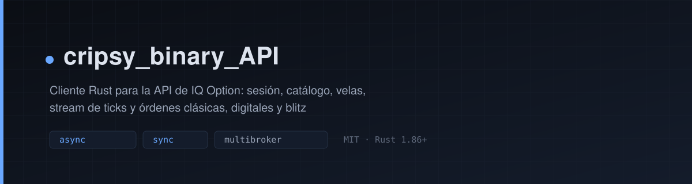

# cripsy_binary_API



[](LICENSE)
[](https://www.rust-lang.org)
[](https://ionixcorp.github.io/cripsy_binary_API/)
[](https://github.com/ionixcorp/cripsy_binary_API/actions)
[](https://crates.io/crates/cripsy-binary-api)
[](https://docs.rs/cripsy-binary-api)

Librería cliente en Rust para brókers de opciones binarias. Un mismo contrato
(`Broker`) cubre sesión, catálogo, velas, ticks y órdenes rise/fall; cada
adaptador traduce su protocolo. Hoy están integrados **IQ Option** (rise/fall,
digital y blitz) y **Deriv** (rise/fall, con mercado público sin credenciales).
El núcleo es `async`; la fachada bloqueante `SyncBroker` sigue disponible para
IQ Option.

Los resultados de las operaciones se entregan como eventos. El último resultado
se lee de una caché local alimentada por esos eventos, sin consultar al bróker.

```rust
let broker = IqOptionBroker::nuevo(BrokerParams::IqOption(cfg)).await?;

let id = broker.buy_binary(BuyBinaryRequest {
    symbol: "EURUSD-OTC".into(),
    amount: 1.0,
    direction: Direction::Call,
    expiration_minutes: 1,
    option_type: OptionType::Binary,
}).await?;

// El cierre llega por el stream de eventos.
let mut eventos = broker.events().await?;
while let Some(evento) = eventos.next().await {
    if let Event::OrderClosed { id: cerrada, result } = evento {
        if cerrada == id {
            println!("orden {id}: {result:?}");
            break;
        }
    }
}
```

## 🎯 Alcance

La API opera **opciones binarias rise/fall** (`CALL`/`PUT`) en todos los activos
que el bróker habilite, y entrega **datos de cualquier activo**: catálogo,
velas y ticks nativos. No es una limitación técnica, es el mercado objetivo.
Otras familias (multiplicadores, acumuladores, dígitos, barreras) quedan
documentadas como expansión futura y no se simulan sobre rise/fall.

## 🧩 Brókers

| Bróker | Operación | Datos | Credenciales |
|---|---|---|---|
| IQ Option | rise/fall, digital, blitz | catálogo, velas, ticks | propias |
| Deriv | rise/fall | catálogo, velas, ticks nativos | opcionales: modo público gratuito |

Deriv funciona sin credenciales para mercado y cotización de payout; operar
exige un PAT con scope `trade` (o un access token OAuth). Copia `.env.example`
a `.env` y completa solo lo que uses: `.env` nunca se versiona.

Densidad de ticks medida (ventana de 8 s, gateway público de Deriv,
2026-11-09): `R_100` ≈0,5/s (índice de 2 s), `1HZ100V` y `1HZ10V` 1,0/s,
`frxAUDCAD` 1,0/s, `cryBTCUSD` 1,0/s y `frxXAGUSD` entre 0,75 y 1,0/s. IQ Option mide
~3 ticks/s por activo en mercados OTC. En ambos casos es el stream del bróker,
sin polling.

## 📌 Estado del proyecto

Versión `0.3.3`. Cada componente se probó mediante conexiones reales contra el
bróker (cuenta de práctica) el 8 y 9 de noviembre de 2026.

**IQ Option**

| Componente | Estado | Comprobación |
|---|---|---|
| Conexión y sesión | Probado contra el bróker | Login, perfil y balances |
| Catálogo de activos | Probado contra el bróker | 791 activos con metadatos |
| Velas históricas | Probado contra el bróker | 1 s – 1 día, descarga paginada |
| Stream de velas | Probado contra el bróker | Velas en vivo por suscripción |
| Ticks de precio | Probado contra el bróker | Stream nativo por activo |
| Órdenes clásicas | Probado contra el bróker | Resultado por evento y caché |
| Órdenes digitales | Probado contra el bróker | Cierre por evento |
| Órdenes blitz | Probado contra el bróker | Duraciones en segundos |
| Venta anticipada | Probado contra el bróker | Aceptada dentro de la ventana |
| Perfil de activo (GraphQL) | Probado contra el bróker | Nombre, ticker y variaciones |
| Historial de posiciones | Probado contra el bróker | PnL realizado y apalancamiento |
| Indicadores del bróker | Depende del activo | El bróker rechaza algunos activos |
| Canales de plataforma | Probado contra el bróker | Comisiones y live-deal |

**Deriv**

| Componente | Estado | Comprobación |
|---|---|---|
| Modo público | Probado contra el bróker | 89 activos, velas y payout sin credenciales |
| Sesión autenticada | Probado contra el bróker | OTP por REST, balance demo y offset |
| Ticks nativos | Probado contra el bróker | Índice, forex, cripto y materia prima |
| Compra y venta rise/fall | Probado en cuenta demo | `Win(0.21)` y venta anticipada |
| Cierre por evento | Probado en cuenta demo | `proposal_open_contract` |
| Historial | Probado contra el bróker | `profit_table` paginado, PnL derivado |
| Reconexión | Probado contra el bróker | OTP nuevo, replay y 2 396 ms de caída |
| Reconciliación | Probado en cuenta demo | Cierre tras 72 s sin red, un solo evento |

Los detalles, límites y casos no soportados están en
[`docs/01_introduccion.es.md`](docs/01_introduccion.es.md).

## 🧩 Funcionalidades

La librería incluye las siguientes funcionalidades:

| | Área | Descripción |
|---|---|---|
| 🔐 | Sesión | Autenticación, WebSocket, perfil y balances (incluye saldo retenido y bonos); cambio entre cuenta de práctica y real en caliente |
| 📊 | Catálogo | Activos con payout, duraciones, importes mínimo y máximo, sector, proveedor de precio y horarios |
| 🕯️ | Velas históricas | Intervalos de 1 segundo a 1 día; consulta puntual por rango y descarga paginada con detección de huecos |
| ⚡ | Stream | Suscripción a velas por intervalo y recepción de ticks nativos del activo |
| 🎯 | Órdenes | Clásicas (turbo y binary), digitales v2, blitz v2 y venta anticipada (buyback) |
| 📈 | Resultados | Cierre tipado (`Win`, `Loss`, `Equal`) por evento, con caché consultable |
| 💱 | Cotización | `quote_payout` por expiración y tipo; devuelve `available: false` en vez de inventar un payout |
| 🧾 | Historial | Posiciones cerradas con PnL realizado, importe invertido y apalancamiento |
| 🌐 | Datos de plataforma | Perfil fundamental del activo, comisiones en vivo y operaciones de terceros |
| 🧠 | Señales del bróker | Humor de traders, activos populares e indicadores publicados por el bróker |
| 🔁 | Modos de consumo | `async`/`await` en todos los brókers; `SyncBroker` bloqueante para IQ Option |
| 🔌 | Continuidad | Reconexión automática con reautenticación, replay de suscripciones y aviso por eventos |
| 🧩 | Multibróker | El trait `Broker` y un registro de adaptadores separan el dominio del transporte |
| 🪙 | Deriv | Adaptador propio (REST + OTP + WebSocket), modo público y cuenta demo/real |
| 📡 | Densidad nativa | Ticks por activo sin polling, con replay de suscripciones al reconectar |

### Datos disponibles a través de la API

Además de las operaciones, la interfaz permite leer metadatos que el bróker
publica en su inicializador: ventana de venta anticipada, margen previo al
cierre, proveedor del precio, decimales, rollovers de blitz, comisiones y
operaciones de otros usuarios del instrumento.

## 🔌 Continuidad de la conexión

La librería mantiene la sesión por sí misma. **No hace falta que implementes un
sistema anticaída encima**: si el WebSocket se interrumpe, la sesión
reautentica, restaura perfil, balances y catálogo, reproduce todas las
suscripciones y vuelve a despachar.

Lo que el consumidor debe saber:

- **Aviso por eventos**: `Event::Disconnected { motivo }` al perder la conexión
y `Event::Reconnected { intentos, downtime_ms }` al recuperarla. No hay que
reiniciar el bróker ni volver a suscribirse.
- **Mientras no hay socket**: las llamadas devuelven `BrokerError::NotConnected`
en lugar de encolarse. En opciones binarias, diferir una orden 30 segundos
cambia el mercado y el resultado.
- **Órdenes en vuelo**: se descartan con error y no se reenvían. Un cierre
ocurrido durante la caída se recupera al reconectar recorriendo el historial de
posiciones, hasta 10 páginas de 100.
- **Streams**: los que ya tenías siguen siendo válidos y se reanudan solos.
- **Cola acotada**: `TransportConfig::cola_salida` limita lo pendiente de
enviar; si se llena, el productor espera en vez de crecer en memoria.
- **Backoff**: `backoff_base_ms` … `backoff_max_ms`. Un rechazo de credenciales
no se reintenta, para no bloquear la cuenta.

Lo que **no** debe hacer el consumidor: reconectar por su cuenta, repetir el
login ante un error de red, o resuscribir streams tras `Reconnected`. El diseño,
los límites y la personalización están en
[`docs/iqoption/04_operativa/02_reconexion.es.md`](docs/iqoption/04_operativa/02_reconexion.es.md).

## 📦 Instalación

Desde crates.io:

```powershell
cargo add cripsy-binary-api
```

O en `Cargo.toml`:

```toml
[dependencies]
cripsy-binary-api = "0.3"
```

Instalación desde el repositorio (para desarrollo o para probar `master`):

```powershell
git clone https://github.com/ionixcorp/cripsy_binary_API.git
cd cripsy_binary_API
.\installation\install.ps1        # guiado, con aprobación en cada paso
```

Compilación manual:

```powershell
cargo build --release                                            # async (por defecto)
cargo build --release --no-default-features --features blocking  # sync
```

### Python (binding nativo)

El repositorio incluye un binding PyO3/maturin con la misma superficie para
IQ Option y Deriv. El crate de crates.io no cambia: el binding es un paquete
independiente en `python/`.

Desde PyPI:

```powershell
pip install cripsy-binary-api==0.3.1
```

O instala el wheel de tu plataforma desde el release:

```powershell
pip install https://github.com/ionixcorp/cripsy_binary_API/releases/download/v0.3.1/cripsy_binary_api-0.3.1-cp310-abi3-win_amd64.whl
```

El release incluye seis wheels (Linux x64 y arm64, Windows x64 y arm64, macOS
Intel y arm64) y el sdist.

```python
from cripsy_binary_api import Client

cliente = Client.connect_deriv()     # público, sin credenciales
print(len(cliente.assets()), "activos")
cliente.close()
```

El `Client` expone además `buy_digital`, `buy_blitz` e `indicators` para IQ
Option; en Deriv se rechazan de forma explícita.

Estado de PyPI, instalación desde el repositorio y límites:
[`docs/python/01_python.es.md`](docs/python/01_python.es.md).

Las credenciales se leen del entorno. `.env` está ignorado por git:

```dotenv
IQOPTION_EMAIL = "tu-correo@ejemplo.com"
IQOPTION_PASSWORD = "tu-contrasena"

# Deriv (opcional: sin token solo se usa el mercado público y el payout)
DERIV_TOKEN = "tu-token-con-scope-trade"
DERIV_APPID = "tu-app-id"
DERIV_ACCOUNT_ID = "DOT00000000"
```

## ✅ Verificación

Los scripts incluidos ejecutan comprobaciones reales contra el bróker. Leen
`.env`, usan la cuenta de práctica y no requieren configuración adicional:

```powershell
.\scripts\iqoption\conectar.ps1            # IQ Option: sesión, balance, catálogo, velas y stream
.\scripts\iqoption\balance.ps1             # IQ Option: balance, tipo de cuenta y balance_id
.\scripts\iqoption\operar.ps1              # IQ Option: orden de 1 USD en demo y cierre por evento
.\scripts\iqoption\verificar_iqoption.ps1  # IQ Option: verificación integral
.\scripts\deriv\verificar_deriv.ps1        # Deriv: público, ticks, órdenes y caídas en demo
.\scripts\verificar_todo.ps1               # ambos, en secuencia
```

Cada verificador informa `[OK]`, `[FALLO]` o `[AVISO]` por capacidad y termina
con código 1 si algo falla. `-SoloLectura` omite las órdenes y las caídas
forzadas.

Resultados de la última ejecución (cuentas demo, 9 de noviembre de 2026):

- **IQ Option:** 34 comprobaciones correctas, 0 fallos, 1 aviso — el bróker no
  publica indicadores para el activo consultado.
- **Deriv:** conexión pública y autenticada, 6 activos con ticks, compra/venta
  `Win(0.21)`, reconexión con OTP nuevo (2 396 ms) y reconciliación de un cierre
  ocurrido durante 72 s sin red, sin reenviar la orden.

## 🧭 Uso

```powershell
cargo run --example ejemplo_lectura      # IQ Option (async)
cargo run --example ejemplo_sincrono     # IQ Option (fachada bloqueante)
cargo run --example ejemplo_orden_demo   # IQ Option: orden demo y cierre
cargo run --example verificar_todo       # IQ Option: verificación integral
cargo run --example deriv_conectar       # Deriv: público o cuenta demo
cargo run --example deriv_ticks          # Deriv: ticks nativos y reconexión
cargo run --example deriv_densidad       # Deriv: densidad por activo
cargo run --example deriv_orden_demo     # Deriv: compra/venta rise/fall demo
cargo run --example deriv_reconciliacion # Deriv: cierre ocurrido sin red
```

## 📚 Documentación

- En línea: <https://ionixcorp.github.io/cripsy_binary_API/>
- En el repositorio: [`docs/`](docs/) (Markdown, fuente de verdad)

| Grupo | Documento | Contenido |
|---|---|---|
| General | [Introducción](docs/01_introduccion.es.md) | Alcance, estado de cada componente y qué no hace |
| IQ Option | [Cuenta](docs/iqoption/01_cuenta/01_sesion_cuentas.es.md) | Conexión, cuentas y balances |
| IQ Option | [Mercado](docs/iqoption/02_mercado/01_historicos.es.md) | Históricos, stream, ticks y fachada síncrona |
| IQ Option | [Órdenes](docs/iqoption/03_ordenes/01_binary.es.md) | Binary, digital y blitz |
| IQ Option | [Operativa](docs/iqoption/04_operativa/02_reconexion.es.md) | Indicadores del bróker y reconexión |
| Deriv | [Introducción](docs/deriv/01_introduccion.es.md) | Alcance, modos y estado |
| Deriv | [Cuenta](docs/deriv/02_cuenta/01_cuentas_identificadores.es.md) | PAT, OTP, cuentas e identificadores |
| Deriv | [Mercado](docs/deriv/03_mercado/01_catalogo_velas_ticks.es.md) | Catálogo, velas, ticks, payout y densidad |
| Deriv | [Órdenes](docs/deriv/04_ordenes/01_rise_fall_historial.es.md) | Rise/fall, cierre por evento e historial |
| Deriv | [Operativa](docs/deriv/05_operativa/01_reconexion_reconciliacion.es.md) | Reconexión y reconciliación |
| Deriv | [Límites](docs/deriv/06_limites/01_limites.es.md) | Cupos y capacidades no soportadas |
| Python | [Binding](docs/python/01_python.es.md) | PyO3/maturin: instalación, superficie y límites |
| General | [Herramientas](docs/herramientas/01_herramientas.es.md) | Instalación, scripts y adaptadores |

Para generar la documentación navegable en local:

```powershell
.\scripts\build_docs.ps1 -Lang es    # genera docs/site/es/index.html
```

- **VS Code:** instala la extensión **Live Server** (Go Live) y pulsa *Go Live*
  sobre `index.html` o `docs/site/es/index.html`.
- **Manual:** abre `docs/site/es/index.html` con doble clic. Funciona sin
  servidor (`file://`): la navegación es por hash y no usa `fetch`.

## 🗂️ Estructura

```
src/domain/      modelo puro: activos, velas, órdenes, posiciones, eventos
src/broker/      trait Broker, configuración, adaptadores y fachada sync
src/transport/   HTTP/WebSocket, reintentos con backoff y router request_id
examples/        uso real y generador de documentación
docs/            guía de usuario (Markdown, fuente de verdad)
scripts/         compuerta de calidad, documentación y verificadores
installation/    instalación guiada y verificación de entorno
```

## 🗺️ Hoja de ruta

El trait `Broker` y el registro de adaptadores permiten incorporar nuevos
brókers sin modificar el dominio ni el transporte. **IQ Option** y **Deriv** ya
están integrados; en próximas versiones se prevé añadir otros, entre ellos
**Quotex**. El orden y el alcance dependerán de la disponibilidad de sus
interfaces documentadas y de las pruebas correspondientes. No hay fechas
comprometidas.

Las propuestas y discusiones se atienden en los issues del repositorio.

## 🧪 Calidad

```powershell
.\scripts\verify.ps1   # fmt + clippy -D warnings + 85 tests + build blocking + docs
```

La compuerta es la misma que se ejecuta en Windows y en Linux. Los tests no
acceden a la red ni requieren credenciales.

## 🛡️ Seguridad

- Las credenciales se reciben por entorno; el repositorio no contiene secretos.
- La verificación de certificados TLS está activa por defecto (`verify_tls`).
- Los ejemplos y scripts usan cuenta de práctica; operar con cuenta real exige
  elegir `AccountSelection::Real` de forma explícita.

## ⚖️ Alcance y limitaciones

La librería traduce el protocolo del bróker a tipos de dominio y expone los
datos que el bróker entrega. No calcula indicadores técnicos, no gestiona
riesgo ni ejecuta estrategias.

El alcance de la garantía cubre el uso del trait `Broker` y de los canales
descritos en `docs/`. Queda fuera del alcance hablar directamente con el
WebSocket, usar canales no documentados, interpretar importes sin la traducción
del adaptador o modificar el crate en local. Algunos datos dependen de lo que
el bróker decida publicar en cada momento; cuando no los publica, la API
devuelve el error del bróker sin sustituirlo por valores estimados.

Limitaciones conocidas de la versión actual:

- **Reconexión automática con backoff.** Si el WebSocket cae, la sesión se
  reautentica, restaura perfil, catálogo y suscripciones, y lo comunica por
  `Event::Disconnected` / `Event::Reconnected`. Mientras no hay socket, las
  llamadas devuelven `BrokerError::NotConnected`; las órdenes en vuelo no se
  reenvían.
- **`get_operation_result` no consulta al bróker.** Lee la caché de eventos;
  sin el stream activo una orden puede permanecer en `Pending`.
- **`get_payout` devuelve el payout del catálogo.** El parámetro de expiración
  no cambia la consulta; los cambios en vivo llegan por `Event::PayoutChanged`.
  Para una combinación concreta usa `quote_payout`: si el bróker no la ofrece,
  devuelve `available: false` y no inventa un porcentaje.
- **Sin baja explícita de suscripciones.** Al soltar el `CandleStream`, la
  suscripción se retira en el siguiente despacho de velas.
- **Pérdida de eventos.** Si el consumidor se atrasa más que el buffer (1024),
  recibe `Event::EventsLost { count }` y el stream continúa.
- **Deriv no tiene fachada sincrónica.** `SyncBroker` sigue siendo exclusivo de
  IQ Option; el adaptador Deriv es `async`.
- **Identificadores de Deriv.** Las cuentas son cadenas (`DOT…`, `VRTC…`,
  `CR…`); `balance_id` y `Asset.opcode` usan un sustituto determinista
  documentado. Usa `symbol` y `account_id`.

```rust
use cripsy_binary_api::{mensaje_consumidor, revisar_config};

println!("{}", mensaje_consumidor());
for aviso in &revisar_config(&cfg).advertencias {
    eprintln!("aviso de uso: {aviso}");
}
```

## 🧱 Base conceptual

El diseño se apoya en el conocimiento público del protocolo que la comunidad
documentó, en particular en la API original de IQ Option publicada en GitHub.
Este proyecto es una implementación desde cero: no incluye código de aquella ni
la usa como dependencia.

Proyecto independiente: no está afiliado, patrocinado ni respaldado por
IQ Option. La licencia MIT cubre el código de este repositorio, no las marcas ni
los protocolos de terceros.

## ❤️ Apoyar el proyecto

El proyecto es gratuito y se mantiene sin patrocinadores. Si te resulta útil y
quieres contribuir a sostenerlo, puedes enviar una donación por Binance Pay.
Es totalmente opcional: no desbloquea funciones, no cambia la prioridad de los
issues y no condiciona el soporte.


**Alias de Binance Pay:** `CripSy-AGKY`

Contribuir no pasa solo por el dinero: un informe de error con pasos para
reproducirlo, una corrección en la documentación o un pull request ayudan
igual o más.

## ⚠️ Aviso

Este software no constituye asesoría financiera. Operar opciones binarias
implica riesgo de pérdida del capital y puede estar restringido por la
legislación de cada país o por los términos del bróker.

## 📄 Licencia

MIT — ver [`LICENSE`](LICENSE).
